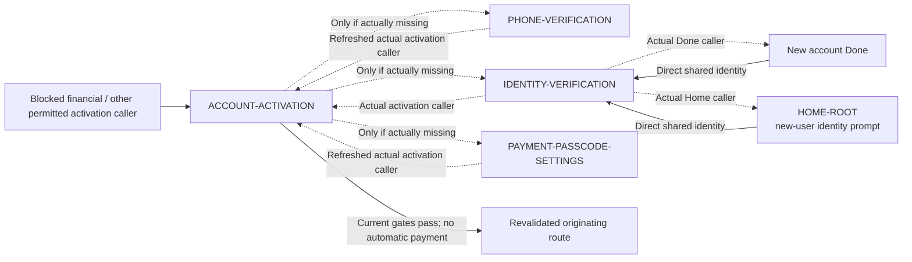

# PayPlus Account Activation Route Map

Status: Current discussion reference
Owner: DOC-06B
Last updated: 2026-11-13

This route-family map shows Account Activation as an orchestration route. It invokes only the missing setup steps and does not become the canonical parent of the reusable account-control routes.

Done and the new-user Home identity prompt are direct shared-identity callers, not compulsory activation-checklist entries. Phone is already verified in new registration; missing Payment Passcode alone does not revive the identity-only Home prompt. Other existing protected callers invoke only their actual missing requirements. Dotted arrows are mutually contextual returns/handoffs, not new parentage or simultaneous destinations.

`PHONE-VERIFICATION` and `IDENTITY-VERIFICATION` are canonically under `ACCOUNT-PROFILE`. `PAYMENT-PASSCODE-SETTINGS` is canonically under `ACCOUNT-SECURITY`.

Each child returns to its actual caller: activation, Done, Home or its canonical account/security parent. Home's identity-only completion prompt disappears on authoritative identity completion. Any protected continuation still revalidates all actual domain/security/financial requirements; preserved context is not authorization.

Set, Retry, Processing, Update, Change, and Reset are internal modes or screen states within the three reusable child flows. They are not additional destinations and therefore do not add nodes to this map.

Each child-flow result maps to a business Outcome and permitted Resolution Strategy before user-facing Message/CTA or notification selection. That decision logic does not change this route hierarchy.
