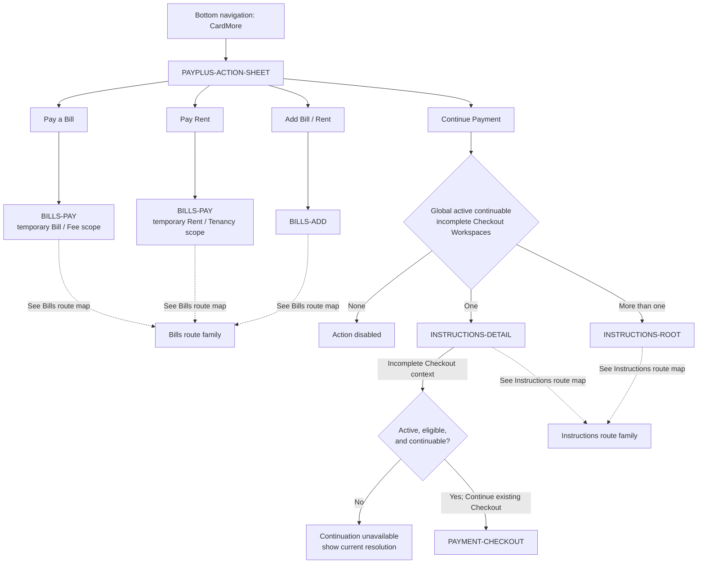

# CardMore Action Sheet Route Map

Status: Current discussion reference
Owner: DOC-06B
Last updated: 2026-11-16

This map owns the four accepted `PAYPLUS-ACTION-SHEET` handoffs. Destination internals belong to their route-family maps. It defines behavior, not final visual design.

The CardMore sheet contains only the accepted Bill, Rent, Add Bill / Rent, and Continue Payment actions. Retired Request and Linking runtime is not a current CardMore destination.

After `Continue Payment` reaches `INSTRUCTIONS-DETAIL`, only an incomplete Checkout that remains active, eligible, and continuable may follow the connected continuation edge to the existing `PAYMENT-CHECKOUT`.

Deliberate pay-later Instructions and their dedicated Pay Now branch are retired. Owner-review-blocked active continuable Checkouts remain counted and visible but cannot continue until the concrete gate clears; label-only review does not block when every applicable gate passes. Continuation enters only the exact existing eligible Checkout and cannot create a replacement. Current revalidation/fresh authorization and the common Bill/Rent Pay resolver remain with DOC-06B/DOC-09; no stale authorization or silent funding/submission follows from this sheet.
