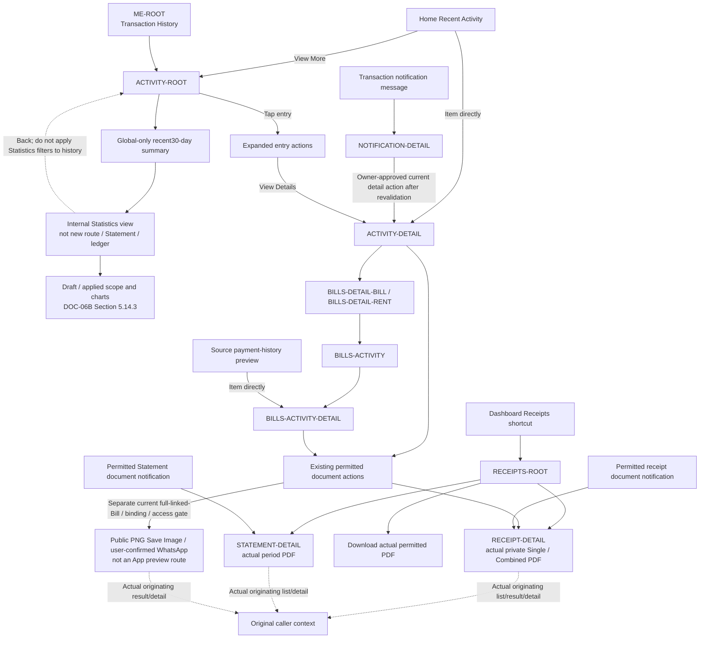

# PayPlus Activity and Receipts Route Map

Status: Current discussion reference
Owner: DOC-06B / DOC-06C
Last updated: 2026-11-13

The global record list, source history and immutable financial detail retain separate scopes/callers; cold financial detail falls back safely to Activity. Statistics uses one applied scope and the selected control/chart/Back contract; production metric/date/refund/fee/time/category/label inputs remain Open (R03), not fixture arithmetic or a second ledger.

Private zero/one/two-or-more eligible confirmed Payment membership governs unavailable/Single/Combined presentation and individual Single access under DOC-08 Section 12.1. A partial leg may have a private receipt without public-proof entitlement. Public seven-field PNG/current full-linked-Bill eligibility is separate under Section 12.2; actual save completion, download initiation, cancel/failure and native handoff limits must be truthful (R04). Document notifications retain their specifically permitted owning entries/access checks; a notification-message action follows Detail-first/current revalidation. The unadopted Me-to-Receipts edge is absent; the existing receipt routes/callers are not retired.

Only independently permitted confirmed-result artifacts may precede optional source Save under DOC-05 Section 10.1 and return to that Result; the exception gives no general history/list or later Save-from-Activity right.
