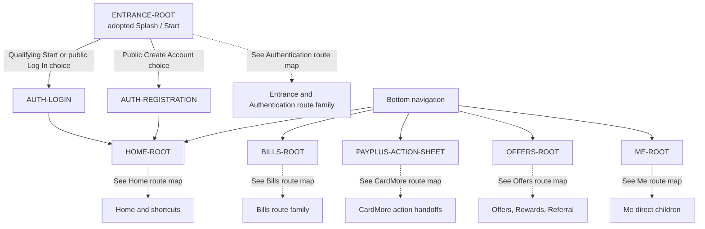

# CardMore App Route Map

Status: Current discussion reference
Level: 0 - app navigation
Owner: DOC-06B
Last updated: 2026-11-17

This map shows only primary app entry and direct global destinations. Entry edges abbreviate DOC-06B's in-root Start/public choice sheet or qualifying remembered-session PIN branch; they are not direct horizontal buttons or an interstitial. Detailed conditions, dismissal and safe returns belong to the authentication map. The canonical destination inventory is `docs/traceability/route-register.md`.

