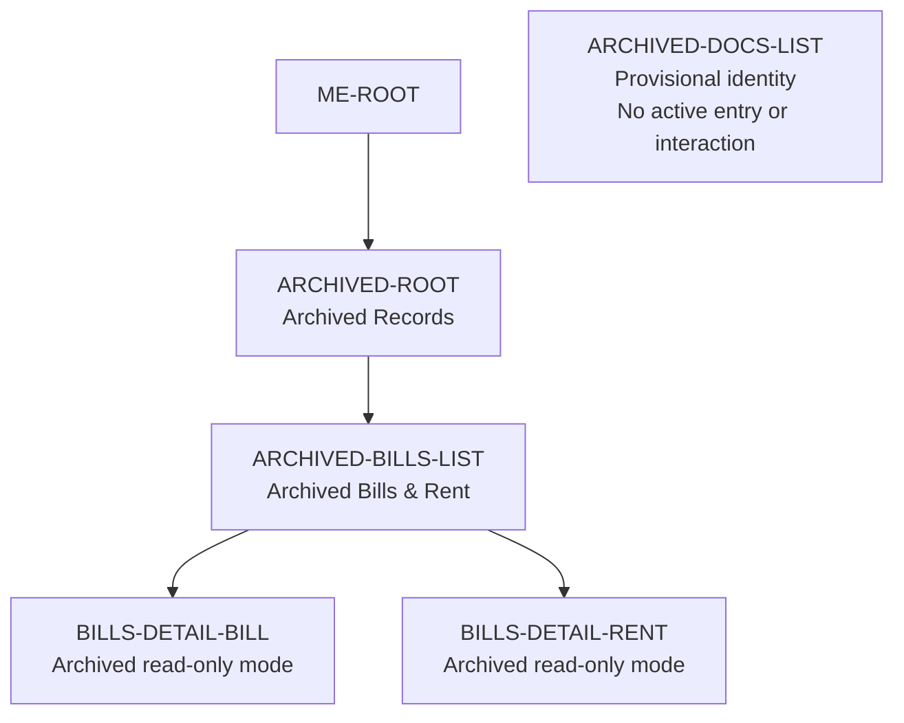

# CardMore Archive Route Map

Status: Current discussion reference
Owner: DOC-06B / DOC-06C
Last updated: 2026-11-16

This map is a derived projection of the Archive route family; DOC-06B, DOC-06C and the route register remain authoritative. A Payer's Saved/current Bill/Rent source moves to the Saved/Archived presentation of the same source, excluded from the active/current list. Archived is not readiness or a financial state. History-only sources after confirmed Payment without Save are not Saved/current or Saved/Archived. Archive does not erase or rewrite Evidence or financial history; Bills and Rent retain their separate Evidence rules.

`ARCHIVED-DOCS-LIST` is a provisional identity with no active entry or interaction, shown separately rather than as a navigation destination. Detailed Restore eligibility, revalidation, prior-version and Evidence-version presentation remain deferred to their owners. Applicable DOC-10 payout/reconciliation and DOC-11 case blockers remain effective; this map defines no blanket restriction on read-only access. `BILLS-ACTIVITY` is scoped by DOC-06C to a Saved/current source; retained history and any permitted access remain owner-governed, and this map defines no archived-detail Activity handoff.

