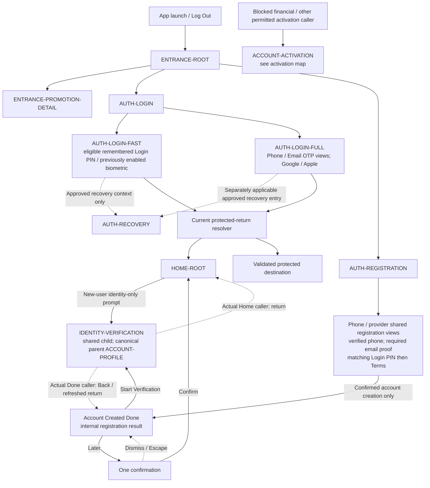

# PayPlus Entrance and Authentication Route Map

Status: Current discussion reference
Owner: DOC-06B
Last updated: 2026-11-13

This map projects DOC-06B Sections 5.0.2/5.0.4–5.0.6. OTP tabs, registration checks, Done and Later are internal views/results, not new destinations. New Done/Home identity callers are direct; other permitted activation callers retain their own orchestration. Canonical verification/passcode parentage remains in the Account Activation/Me owners.

`AUTH-RECOVERY` is one route with internal screens and states. Its capability evaluation, Outcome, and Resolution Strategy do not create additional route nodes. A permitted resolution may continue or restart Recovery, redirect to an available login method, wait for a controlled condition, hand off to Support, or stop as Recovery Not Permitted.

Phone/email/provider proofs remain purpose/recipient/attempt/revision-bound; unknown send/create reconciles the same operation without automatic duplicate effects. Optional password/recovery is not a password field in the adopted Full Login OTP views. Completing identity does not bypass actual financial, Evidence, risk or authorization gates.
