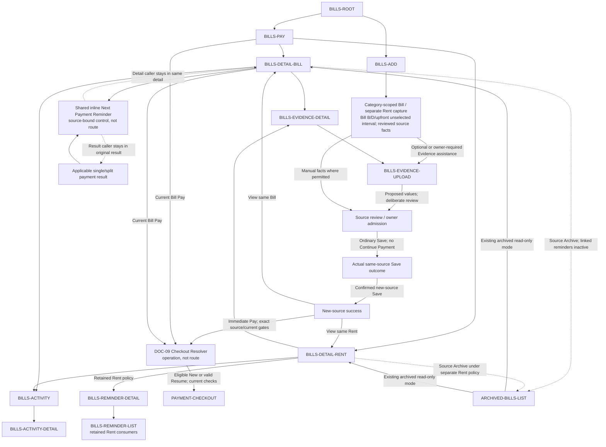

# PayPlus Bills Route Map

Status: Current discussion reference
Owner: DOC-06C
Last updated: 2026-11-13

This map owns the current Bills route family and shows only material external handoffs. Checkout and source Archive retain their own owners; retired Requests, Linking, Receive, and Receiving Info runtime is not represented.

Bills use the accepted Tier 1/2/3 handoffs: Tier 1 uses Declaration without mandatory attached Evidence; Tier 2 requires qualifying official Bill Evidence presence before Payment and acceptance before Payout; Tier 3 may preserve a prepared but non-executable Checkout before approval. Rent remains a separate mandatory attached-Evidence journey. `ARCHIVED-BILLS-LIST` is the Saved/Archived presentation and is excluded from the current Bills list; history-only sources remain outside the Saved/current and Saved/Archived projections.

After an owner-recorded Tier 3 approval, the Payer remains in, or returns to, the current Bill context. A deliberate current `Pay` action invokes the DOC-09 Checkout Resolver; approval itself creates no navigation, route, notification, authorization, Provider Submission, or generic status.

DOC-06C Sections 5.9/5.12 own the ordinary Save/new-source versus edit-success distinction, upfront Bill B/D/I and period-isolated inline preferences, retained Rent LIST/DETAIL and narrow valid-D/missing-B preference-only exception. Instruction-origin source-add takes its confirmed same-account Save return to the original Instruction draft rather than inferring success from cancel/unknown; see the Instructions map. Immediate-pay capture has no forced prior Save. All source/Evidence/C1/tier/Rent/destination/risk/authorization gates remain.

Unknown source Save and the narrow independently eligible confirmed-result artifact exception follow DOC-05 Section 10.1; no general history/list or Save-from-Activity entitlement is created. `ARCHIVED-DOCS-LIST` remains a provisional identity with deeper document/version/Restore interaction deferred; this map adds no such active edge. Archive is neither paid confirmation nor erasure, and edit success does not gain the new-source Pay CTA.
