# PayPlus Home Route Map

Status: Current discussion reference
Owner: DOC-06B
Last updated: 2026-11-13

This map projects the DOC-06B Home presentation and navigation baseline against the route register; it does not independently own behavior. Home has a default and maximum of 8 shortcuts, with up to 7 configurable entries plus protected `More`; the effective set may contain fewer configurable entries. Greeting is presentation-only and has no navigation action. Pay+ and destination internals belong to their route-family maps.

```mermaid
flowchart TD
  HOME["HOME-ROOT"] -->|"Inbox utility"| INBOX["NOTIFICATION-INBOX"]
  HOME -->|"Rewards utility"| REWARDS["REWARDS-ROOT"]
  HOME --> NOTICE["Important Notice"]
  HOME --> SHORTCUTS["Shortcut grid<br/>1-8 effective entries; More protected/final"]
  HOME --> HOTOFFER["Home Hot Offer"]
  HOME --> UPCOMING["Upcoming Bills / Rent<br/>source-derived calendar / manual-label view"]
  HOME --> RECENT["Recent Activity"]
  HOME -->|"New-user identity-only prompt"| IDENTITY["IDENTITY-VERIFICATION"]
  IDENTITY -. "Actual Home caller; refresh identity state" .-> HOME
  HOME -->|"No saved source"| EMPTY["Dismissible tutorial / Add / empty composition"]
  EMPTY -->|"Add"| ADD["BILLS-ADD"]
  NOTICE -->|"Body"| NOTICEDETAIL["NOTIFICATION-DETAIL"]
  NOTICE -->|"Action Button"| SOURCEDEST["Source-provided existing destination"]
  NOTICEDETAIL -->|"Another eligible notice"| INBOX
  NOTICEDETAIL -->|"No other eligible notice"| HOME
  INBOX -. "Actual Home return" .-> HOME
  REWARDS -. "Return" .-> HOME
  SHORTCUTS --> INSTRUCTIONS["INSTRUCTIONS-ROOT"]
  SHORTCUTS --> BILLS["BILLS-ROOT"]
  SHORTCUTS --> RECEIPTS["RECEIPTS-ROOT"]
  SHORTCUTS -->|"Retained Rent consumer only"| REMINDERS["BILLS-REMINDER-LIST"]
  SHORTCUTS --> PROFILE["PAYMENT-PROFILE-ROOT"]
  SHORTCUTS --> REFERRAL["REFERRAL-ROOT"]
  SHORTCUTS --> MORE["MORE-ROOT"]
  HOTOFFER -->|"Card / CTA"| OFFER["OFFER-DETAIL"]
  OFFER -. "Home / prior carousel position" .-> HOME
  UPCOMING --> FILTERS["Internal date / label selection<br/>max-three / Show All; independent disclosure"]
  FILTERS -->|"Pay; source revalidates"| BILLSPAY["BILLS-PAY"]
  FILTERS -->|"View Details: Bill"| BILLDETAIL["BILLS-DETAIL-BILL"]
  FILTERS -->|"View Details: Rent"| RENTDETAIL["BILLS-DETAIL-RENT"]
  RECENT -->|"View More"| ACTIVITY["ACTIVITY-ROOT"]
  RECENT -->|"Item directly"| ACTIVITYDETAIL["ACTIVITY-DETAIL"]
  ACTIVITYDETAIL -. "Actual Home origin" .-> HOME
  ACTIVITY -. "See Activity / Statistics map" .-> ACTFAMILY["Activity route family"]
  HOME --> PAYPLUS["PAYPLUS-ACTION-SHEET"]
  PAYPLUS -. "See Pay+ map" .-> PAYPLUSHANDOFFS["Pay+ handoffs"]
  INBOX -. "See Notifications map" .-> NOTIFICATIONFAMILY["Notifications family"]
```

DOC-06B Section 5.8 owns the default7-day/label21-day/selected-date intersection, independent All/retap, month/Today/rail and disclosure/Show All behavior. These are views, not destinations or generated obligations; ranking, due facts, permission/readiness and protected Pay remain source-owned. The global Statistics child is expanded only in its own family map. Bill reminder settings stay inline on their source, not in the retained Rent shortcut. Ordinary CTAs scroll with content; genuine overlays retain their placement.
