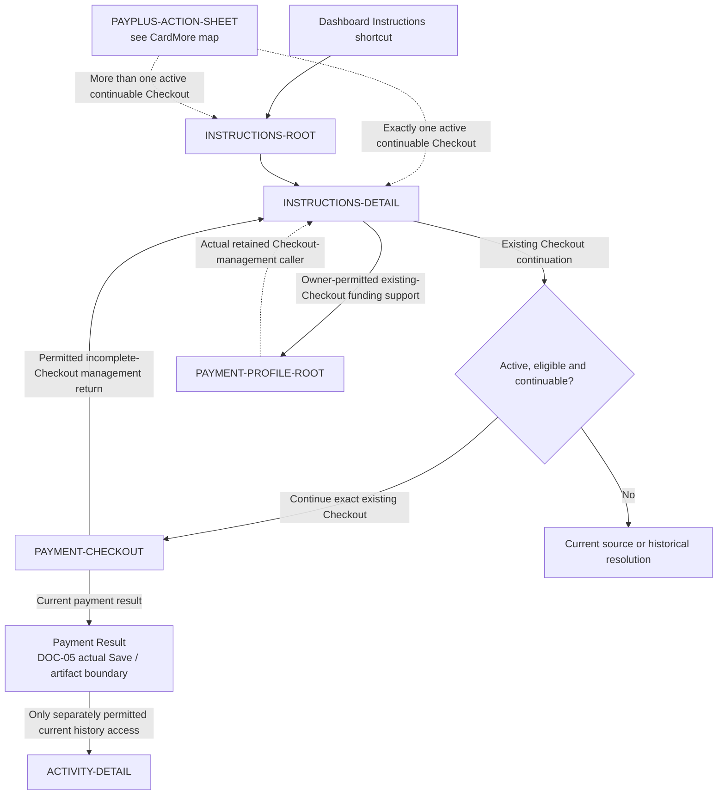

# CardMore Payment Instructions Route Map

Status: Current discussion reference
Owner: DOC-06B / DOC-09
Last updated: 2026-11-16

This projects the retained Instructions route identities in DOC-06B Section 5.12. Deliberate pay-later setup/actions and dedicated notifications are retired; the existing route title/IDs do not reinstate that feature.

Global CardMore continuation counts active continuable incomplete Checkouts: zero disables the action, one opens detail and more than one opens the list. Owner-review-blocked items remain visible/countable but cannot continue; current gates still govern every action. No dedicated Instruction Pay Now/notification caller, setup/source-add draft/date/target, update/cancel or replacement-Checkout creation branch remains.

Continue enters only the exact existing active, eligible, continuable Checkout within DOC-09's 30-day boundary. Close/Expiry remains an owner-permitted operation ending continuation without rewriting locked Target/Obligation Allocations, funding versions or confirmed Payments/Applications; this projection does not invent its return destination. Historical Checkout is not reactivated and source Archive remains separate. Common Bill/Rent Pay resolution remains with DOC-09; it is not removed or recreated by this map.

Funding support preserves the actual account/caller/current Checkout and returns refreshed facts without automatic authorization/submission. Current obligation, Evidence, eligibility, fee/benefit, destination, risk/security and fresh-authorization requirements remain with their owners. General Notification Detail/current-action safeguards survive under DOC-08 without a replacement alert or direct Checkout edge. Ordinary Bill/Rent reminders remain separate; retained Checkout communication creates no ordinary reminder record.

Optional source Save/unknown Retry/Skip and independently permitted confirmed-result artifacts retain DOC-05 Section 10.1 and the Checkout-map boundary. Cancel/unknown is not confirmed Save; no general Activity/list or Save-from-Activity entitlement follows. Dotted returns are actual-caller alternatives, not simultaneous navigation.
