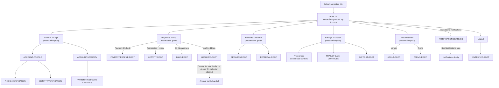

# PayPlus Me Route Map

Status: Current discussion reference
Owner: DOC-06B
Last updated: 2026-11-13

This parent map shows direct Me child destinations and the three material account-control handoffs under Account Profile and Account Security. It intentionally does not duplicate deeper child-route flows.

Phone-verification modes, identity capture/processing/result states, and payment-passcode Set/Change/Reset modes remain inside their reusable child flows. They are not separate route nodes.

Groups, search and at-most-one-open state are presentation, not routes. Every child returns to its actual permitted Me/query/group/position or contextual Checkout/Instruction/notification caller, with no automatic authentication/payment effect. One shared passcode owner and separately controlled email/phone/identity/privacy/closure flows remain in DOC-06B/DOC-15/DOC-19; Verified is not a voluntary re-verification action.

`RECEIVING-INFO` remains retired/non-active provenance, not a Me edge. `RECEIPTS-ROOT` remains an existing destination through other permitted callers, but is not an adopted Me row. The retained Archived Data entry does not approve provisional archived-document, deep Restore or version behavior. Unavailable capabilities remain honest implementation limits.
