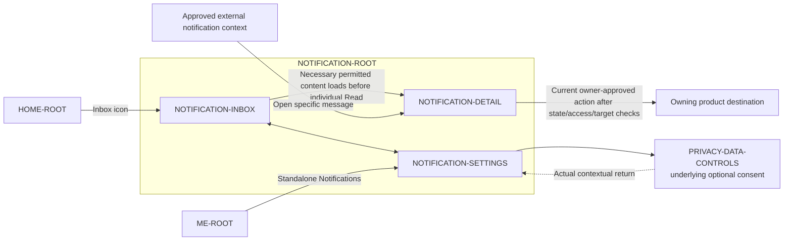

# PayPlus Notifications Route Map

Status: Current discussion reference
Owner: DOC-06B / DOC-08
Last updated: 2026-11-13

This map projects DOC-06B Section 5.19 / DOC-08 Sections 7.2/15. `NOTIFICATION-LIST` and `NOTIFICATION-CARD` are components; category, reading, domain status and action requirement are separate. The adopted MVP exposes no Inbox Archive/Restore affordance or Archived filter. Historical record metadata/retention remains governed and unchanged.

Card tap/failed load does not mark an individual message Read. Existing message content is not current domain eligibility; material actions remain Detail-first/revalidated. Optional preferences take immediate independent effect without page Save, restore prior values on failure and cannot take late effect from expired/superseded operations. Required groups stay locked; account delivery, device permission and Privacy-owned consent differ. Exact operation/expiry/correlation/provider mechanisms remain Open, not a UI polling schedule.
