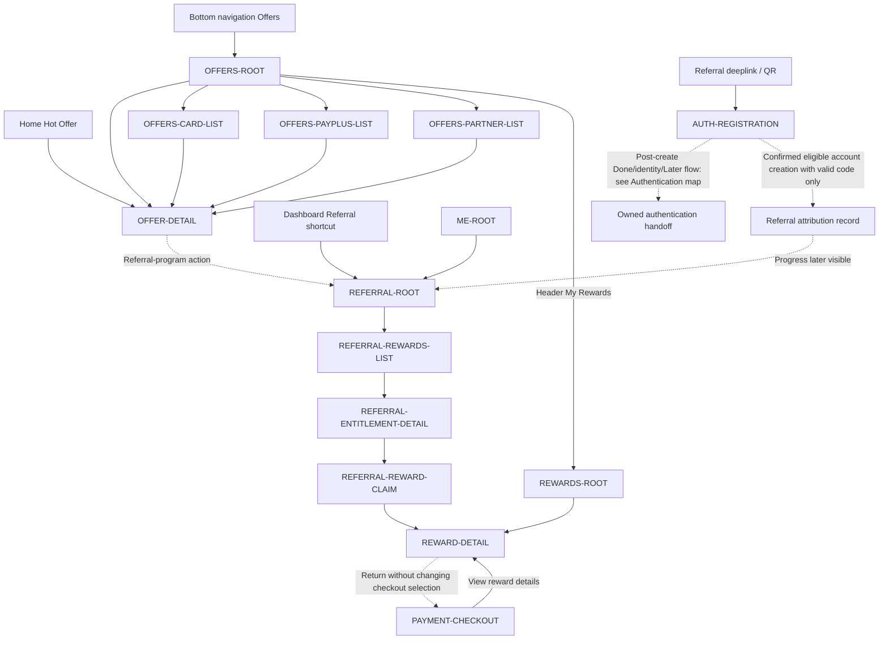

# PayPlus Offers, Rewards, and Referral Route Map

Status: Current discussion reference
Owner: DOC-06B / DOC-13
Last updated: 2026-11-13

Offers remains discovery, Rewards manages issued instruments and Referral preserves qualification/entitlement/claim identities. Current root/child composition and header/filter/search/carousel behavior follow DOC-06B Section 5.16; source/category/status remain independent. Restricted/Soon are conditions, no Rewards featured module or mandatory detailed campaign filters are added, and the seven-day default remains owner-controlled. Browse unassigned qualification differs from named issued Use/usage expiry; view/reveal/copy/external return does not prove consumption.

Manual optional referral code may be corrected/cleared before confirmed creation; incoming deeplink/QR stays non-editable and completed attribution immutable. Sharing alone creates no recipient/attribution. Masked friend progress is its owned child presentation, not another stable destination. `HOME-ROOT` is reached through the owned post-create/return contract, not a direct unconfirmed registration edge. Current state and original caller/claim identity are preserved; partner/native/growth parity remains an implementation limit, not new policy.
