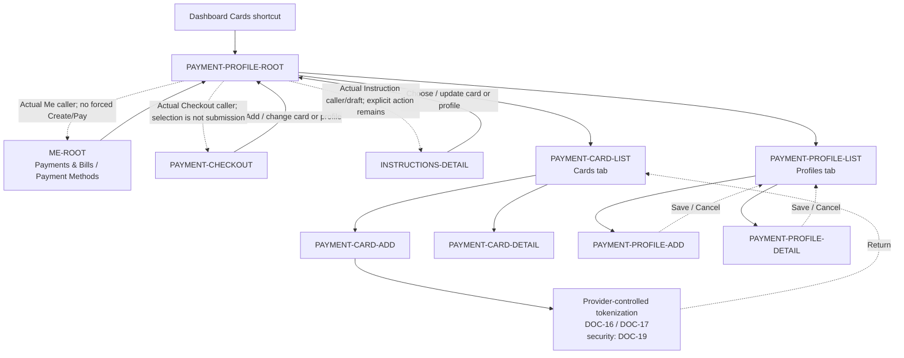

# PayPlus Payment Profile Route Map

Status: Current discussion reference
Owner: DOC-06B / DOC-09
Last updated: 2026-11-13

DOC-06B Sections 5.13.2/5.13.5 own the shared NEW/EDIT ratio editor (100% total) and applicable account/caller/draft/target/mode preservation. Dotted returns are contextual alternatives, not simultaneous navigation. Ordinary Me Save/Cancel returns to Me; Checkout/Instruction alone performs any applicable explicit later financial action. Profile selection/Save never authorizes or submits payment.
