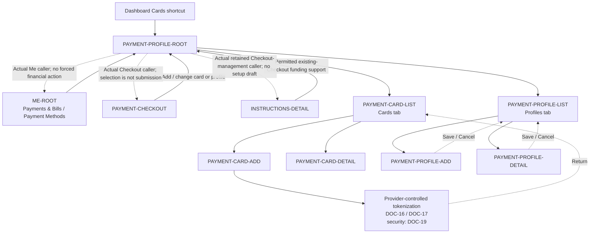

# CardMore Payment Profile Route Map

Status: Current discussion reference
Owner: DOC-06B / DOC-09
Last updated: 2026-11-16

DOC-06B Sections 5.13.2/5.13.5 retain the shared NEW/EDIT ratio editor (100% total), its applicable editor draft and actual account/caller/Checkout allocation-target-mode preservation. Dotted returns remain contextual alternatives. Ordinary Me Save/Cancel returns to Me without forced financial action; permitted Checkout/retained Checkout-management support returns to its actual existing caller, where any later payment action remains explicit and currently gated. Deliberate Instruction setup-draft/Create support is retired. Profile selection/Save never authorizes or submits payment.
